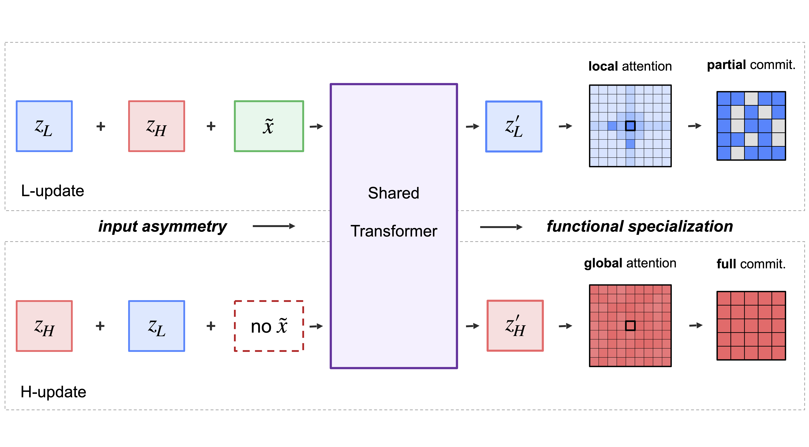

<p align="center">
  <h1 align="center">AIR — Asymmetric Input Recurrence</h1>
  <p align="center">
    <strong>One model, two roles: emergent specialization in a shared recurrent Transformer</strong>
  </p>
  <p align="center">
    <a href="https://arxiv.org/abs/2605.17811"></a>
    <a href="https://akyrillidis.github.io/aiowls/asymmetric_input.html"></a>
    <a href="https://www.python.org/"></a>
    <a href="https://pytorch.org/"></a>
    <a href="https://developer.nvidia.com/cuda-toolkit"></a>
    <a href="./LICENSE"></a>
  </p>
</p>

---

## 📰 News

- **[2026/09]** 🎉 **One Model, Two Roles** has been accepted to **NeurIPS 2026**.

> **"One Model, Two Roles: Emergent Specialization in a Shared Recurrent Transformer"**<br>
> *[Jucheng Shen](https://juchengshen.github.io/)\*, [Wenyi Su](https://www.linkedin.com/in/barbara-su-966314268/)\*, [Anastasios Kyrillidis](https://akyrillidis.github.io/about/)*<br>
> [arXiv:2605.17811](https://arxiv.org/abs/2605.17811)

Can a shared-weight recurrent Transformer develop **two distinct internal roles** without being partitioned into separate modules? AIR (Asymmetric Input Recurrence) is a minimal two-state reasoning architecture in which the **same** Transformer block is reused for both updates, and the only built-in asymmetry is that the encoded input is injected during L-updates but not H-updates:

$$
\textbf{L-update:}\ \ \mathbf{z}_L \leftarrow f\big(\mathbf{z}_L + \mathbf{z}_H + \tilde{\mathbf{x}};\,\theta\big), \qquad
\textbf{H-update:}\ \ \mathbf{z}_H \leftarrow f\big(\mathbf{z}_H + \mathbf{z}_L;\,\theta\big).
$$

Across Sudoku-Extreme and Maze-30×30, this single architectural detail causes the shared model to specialize: $\mathbf{z}_H$ behaves like a fully-committed proposal state while $\mathbf{z}_L$ acts as a shifting scratchpad. With **half** the Transformer parameters of the two-network HRM baseline, AIR **matches or exceeds** its accuracy on both tasks.

<div align="center">
  
</div>

## 🚀 Quick Start

### Prerequisites

Python 3.10+. Install Python dependencies:

```bash
pip install -r requirements.txt
unzip adam_atan2.zip          # bundles the AdamATan2 optimizer
```

If CUDA 12.6 and matching PyTorch wheels are not already installed, one tested setup is:

```bash
# CUDA 12.6
CUDA_URL=https://developer.download.nvidia.com/compute/cuda/12.6.3/local_installers/cuda_12.6.3_560.35.05_linux.run
wget -O cuda_installer.run "$CUDA_URL"
sudo sh cuda_installer.run --silent --toolkit --override
export CUDA_HOME=/usr/local/cuda-12.6

# PyTorch with CUDA 12.6
pip install torch torchvision torchaudio --index-url https://download.pytorch.org/whl/cu126

# Build helpers for the CUDA extensions
pip install packaging ninja wheel setuptools setuptools-scm
```

Training scripts log to [Weights & Biases](https://wandb.ai/):

```bash
export WANDB_API_KEY=your_wandb_api_key
```

### Build the datasets

```bash
python dataset/build_sudoku_dataset.py \
  --output-dir data/sudoku-extreme-1k-aug-1000 \
  --subsample-size 1000 --num-aug 1000

python dataset/build_maze_dataset.py \
  --output-dir data/maze-30x30-hard-1k
```

If you already have prebuilt datasets, place them at `data/sudoku-extreme-1k-aug-1000` and `data/maze-30x30-hard-1k`.

### Train the default AIR variant (Lx_H, the canonical $(n_L, n_H) = (1, 0)$ asymmetric model)

```bash
# Sudoku-Extreme
bash experiment_input-injection-specialization-sudoku/train_sudoku_Lx_H.sh

# Maze-30×30
bash experiment_input-injection-specialization-maze/train_maze_Lx_H.sh
```

### Reproduce the paper results

Each paper experiment has its own `experiment_*/` sub-directory: run the bash scripts in the corresponding sub-directory to reproduce that part of the paper. `run_all_*.sh` scripts submit a full sweep with `sbatch`; on a machine without Slurm, run the individual `train_*.sh` scripts directly. Evaluation scripts (decoding, freeze, attention) read trained checkpoints from `checkpoints/`; edit the path at the top of a script if yours live elsewhere.

## 💻 Hardware

| Hardware | Use | Notes |
|----------|-----|-------|
| 1 × NVIDIA H200 (80 GB) | Single Sudoku training run | ~4 hours per run |
| 8 × NVIDIA H200 (80 GB) | Single Maze training run | ~3 hours per run |
| Any Ampere or newer GPU | Inference / freeze / attention analysis | ≤ 16 GB sufficient for batched eval |

Total compute reported in the paper (all sweeps + preliminary runs): ~500 GPU-hours.

## 📝 Citation

```bibtex
@article{shen2026air,
  title   = {One Model, Two Roles: Emergent Specialization in a Shared Recurrent Transformer},
  author  = {Shen, Jucheng and Su, Wenyi and Kyrillidis, Anastasios},
  journal = {arXiv preprint arXiv:2605.17811},
  year    = {2026},
  url     = {https://arxiv.org/abs/2605.17811}
}
```

## 📖 Blog

- 🧠 [**One Model, Two Roles**](https://akyrillidis.github.io/aiowls/asymmetric_input.html) — Quanta-style walkthrough on AI-OWLS. Decoded rollouts, the symmetric control, the injection-asymmetry ablation, the level-token recovery, the freeze experiments, and the attention split — for a reader outside the subfield.

## 👥 Authors

- [Jucheng Shen](https://juchengshen.github.io/) — `jucheng.shen@rice.edu`
- [Wenyi (Barbara) Su](https://www.linkedin.com/in/barbara-su-966314268/) — `barbara.su@rice.edu`
- [Anastasios Kyrillidis](https://akyrillidis.github.io/about/) — `anastasios@rice.edu`

**Rice University**, Department of Computer Science.
Jucheng Shen and Wenyi (Barbara) Su contributed equally.

## 📄 License

[Apache License 2.0](./LICENSE).
